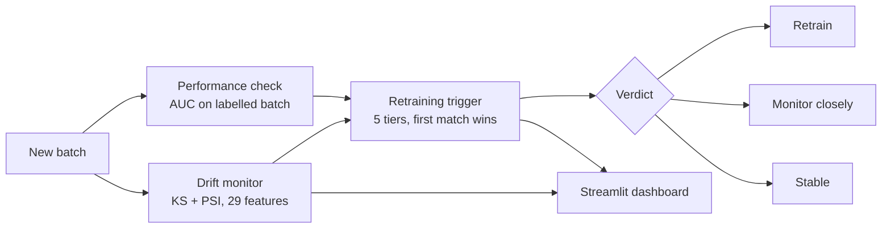
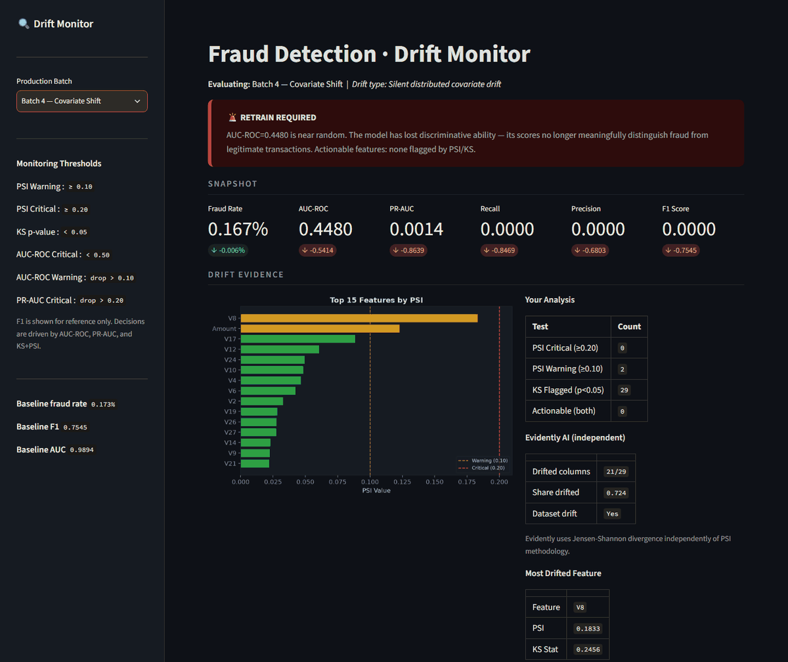
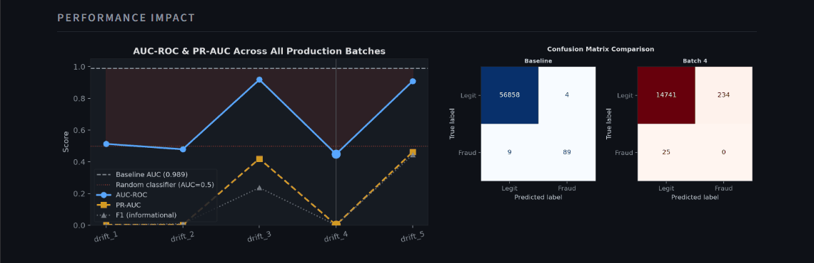

# Fraud-model drift monitoring · when to retrain

**Detect when a credit-card fraud model stops being trustworthy, and turn the signals into a clear verdict: retrain, watch, or leave it alone.**

A three-person team project (April 2026). We trained a fraud classifier, ran it on five simulated production batches with different kinds of drift, and built a monitor, a rule-based retraining trigger and a dashboard around it.

## Setup
- **Data:** the public Kaggle credit-card fraud dataset, 284,807 transactions, 0.173% fraud.
- **Model:** XGBoost with SMOTE oversampling.
- **Baseline test scores:** ROC-AUC 0.989, PR-AUC 0.865, precision 0.680, recall 0.847, F1 0.755.
- **Production batches:** five simulated batches, each with one kind of drift: a localised covariate spike, a collapsed feature, two label-drift batches (fraud rate ×3 and ×11.5), and a "silent" batch where many features shift a little at once.

## Architecture

## Two layers of monitoring
1. **Distribution (no labels needed):** every feature is compared with the training data using a Kolmogorov–Smirnov test and the Population Stability Index (warning at 0.10, critical at 0.20). A feature only counts as *actionable* if it fails both: KS p < 0.05 **and** PSI ≥ 0.20. On large batches KS flags tiny, harmless shifts; the PSI condition filters those out.
2. **Performance (needs labels):** ROC-AUC on the batch once its labels arrive.

## Retraining trigger
Tiers are checked in order and the first match sets the verdict:

| Tier | Condition | Verdict |
|---|---|---|
| 1 | ROC-AUC < 0.50 | Retrain immediately |
| 2 | ≥ 1 feature fails both KS and PSI | Retrain |
| 3 | AUC drop > 0.10, no actionable feature | Monitor closely, recalibrate threshold first |
| 4 | ≥ 3 features at PSI warning, or > 20 features KS-flagged | Monitor, schedule a review |
| 5 | none of the above | Stable |

Label drift alone (the fraud rate changes, the patterns don't) should lead to a threshold recalibration, not a retrain.

## Results
| Batch | Drift | ROC-AUC | Caught by |
|---|---|---|---|
| 1 | Localised covariate spike | 0.513 | both layers (tiers 1 + 2) |
| 2 | Feature collapse | 0.479 | both layers (tiers 1 + 2) |
| 3 | Label drift, fraud ×3 | 0.918 | correctly no retrain |
| 4 | Silent, many small shifts | 0.448 | **performance layer only** |
| 5 | Label drift, fraud ×11.5 | 0.909 | tier 4 warning (a false alarm) |

**Batch 4 is the important one.** No single feature crossed the PSI threshold, so the distribution layer raised nothing, yet AUC fell below 0.5 and the model caught none of the fraud in the batch (recall 0). Distribution monitoring alone misses this kind of failure; labelled performance checks are the safety net, and the count of KS-flagged features (all 29 in batch 4) is a cheap early hint.

**Batch 5 shows the opposite problem:** a large fraud-rate change shifts every feature slightly, so 28 of 29 features fail KS and tier 4 fires while the model is fine. Suppressing tier 4 when AUC stays above about 0.85 would fix it.

## My part
The drift monitor (KS/PSI per feature, the two-key rule, a JSON report), the retraining trigger with its tier logic, and the Streamlit dashboard that runs both on a selected batch and shows the verdict, per-feature PSI and the AUC trend. I also reworked the analysis notebooks and wrote the project README. Teammates owned the EDA and baseline model and the drift analysis.

## Limitations
- The drift batches are simulated, not real production data.
- Labels are assumed to be available per batch; in practice they arrive late, which is exactly when batch-4-type drift hurts.
- Thresholds were set by reasoning, not tuned on historical incidents.
- Notebook-first pipeline: no tests, CI, container or scheduled runs.

**Stack:** Python · pandas · scikit-learn · XGBoost · imbalanced-learn · SciPy · Evidently · Streamlit · matplotlib

*The code lives in a private repository; the dataset is not redistributed here.*
