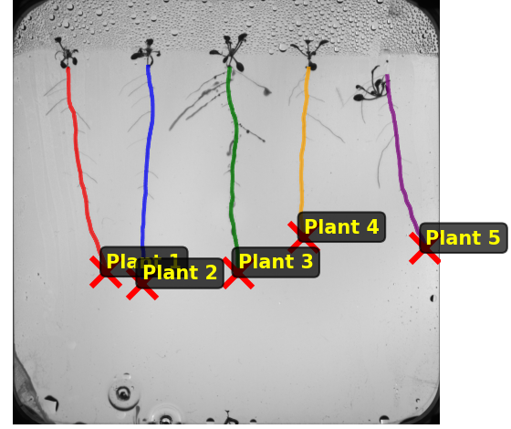
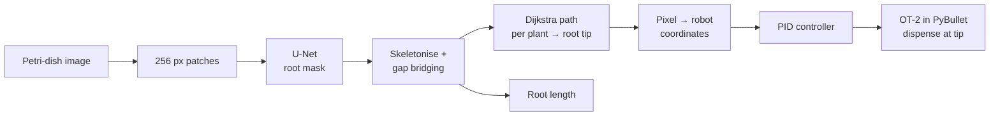
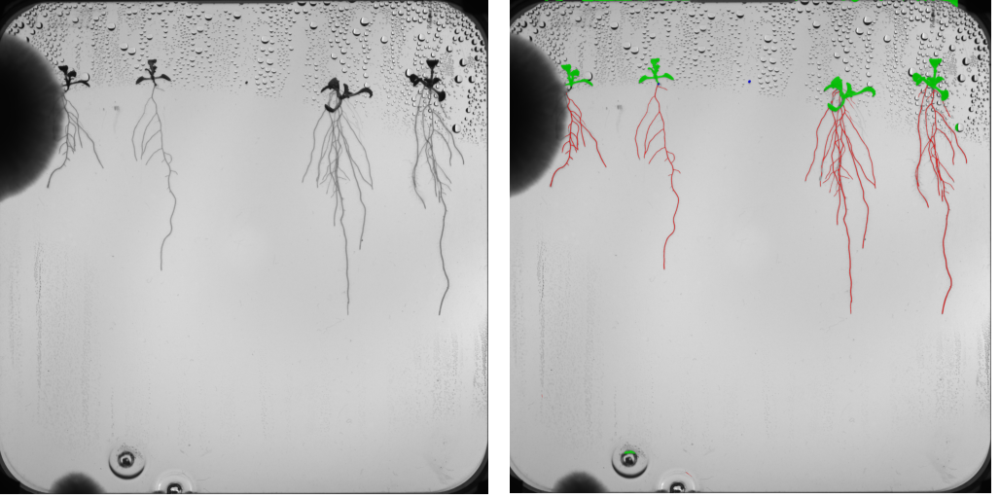

# Plant-root phenotyping · from segmentation to pipette

**Find the roots of Arabidopsis seedlings in petri-dish images, measure them, locate each root tip, and drive a simulated Opentrons OT-2 pipette to it.**

## Pipeline

## Segmentation and measurement
- U-Net in Keras on 256 px patches: **validation F1 0.863** for the root class (pixel level).
- Root length came from the skeleton of the mask. Each plant's root was traced with a Dijkstra shortest path from its top start node to the best end node, with upward moves penalised. A scoring step on pixel count, distance to the plant's anchor and overlap with the core zone picked one region per plant.
- Kaggle competition on root length: **sMAPE 7.18%**, rank 14 on the leaderboard.

## Robot control
- Opentrons OT-2 in a PyBullet simulation, wrapped as a Gymnasium environment. The work envelope was measured first.
- **PID controller** (P 20, I 0.001, D 0.05): 0.1 mm final error on a single test target.
- **SAC agent** (Stable-Baselines3, 3M steps, tracked in Weights & Biases, trained on a ClearML GPU queue), restricted to 2D with Z fixed. Hyperparameters came from a team search.
- Comparison over 3 random targets:

| | Rise | Settling | Overshoot | Final error |
|---|---|---|---|---|
| PID | 0.157 s | 0.314 s | 0% | 0.449 mm |
| SAC | 0.353 s | 3.053 s | 0% | 0.676 mm |

PID was faster and more precise, so the integrated system uses PID.

## Integration
- Pixel to robot: scale = 150 mm divided by the detected plate size in pixels. The image axes map to the robot's X/Y axes. A fixed offset sets the plate corner.
- End-to-end run on one plate with 5 plants: the CV pipeline found the 5 tips, and the PID controller brought the pipette **within the 1 mm tolerance of all 5** before dispensing.

## Architecture study
**Question:** do U-Net++, Attention U-Net or DeepLabV3+ segment roots better than a plain U-Net when everything else is held equal?

- **Data:** 562 images (492 + 70 from a time series) cut into 256 px patches with 50% overlap. 80/10/10 split. 83.6% of patches contain no root, and 99.6% of pixels are background.
- **Controlled setup:** the same DenseNet121 encoder trained from scratch, Soft Dice loss, Adam 1e-4, batch 32, flips and seed 42 for all four models. Early stopping on validation F1.
- **Evaluation:** IoU, Dice, precision, recall, boundary F1 and HD95, stratified by root density. Paired tests: Friedman, then Wilcoxon with Bonferroni and Benjamini–Hochberg correction, with effect sizes. One metric per hypothesis.

Test patches containing roots (n = 157):

| Model | Params | IoU | IoU, sparse patches (<1% root) | Recall |
|---|---|---|---|---|
| Attention U-Net | 13.8M | **0.658** | **0.592** | 0.828 |
| U-Net (baseline) | 8.8M | 0.646 | 0.558 | 0.813 |
| DeepLabV3+ | 13.6M | 0.640 | 0.567 | **0.836** |
| U-Net++ | 15.0M | 0.629 | 0.525 | 0.791 |

**Findings**
- The models differ (Friedman χ² = 47.8, p = 2.3e-10), mainly because U-Net++ is worse.
- Attention U-Net improves recall on sparse patches (p = 0.001, rank-biserial r = 0.62). That is the case that matters for thin, faint roots.
- U-Net++ does not improve HD95, and DeepLabV3+ does not improve IoU.
- The best model beats the baseline by only 0.012 IoU. That gain passes Benjamini–Hochberg but not Bonferroni. Variation within one model (SD ≈ 0.20 per patch) is far larger than the 0.029 spread between models. For this data, extra architecture buys little.

## My part
The pipeline, from segmentation to integration, is my own work; the SAC hyperparameters came from a team search. The architecture study was a team project, in which I owned the architecture comparison and its statistical analysis.

## Limitations
- Simulation only: no real OT-2 run. The 1 mm figure is the controller's stopping tolerance in sim coordinates. It is not tip accuracy measured against ground truth, and calibration error was not measured separately.
- Calibration assumes a fixed plate position (hand-tuned offset, no plate detection).
- The integration test covers one plate with 5 plants.
- Segmentation F1 is a validation score; the pipeline's segmentation model had no separate test set.
- Research code: notebooks, no tests, no packaging.

**Stack:** Python · TensorFlow/Keras · keras-unet-collection · OpenCV · scikit-image · NetworkX · PyBullet · Gymnasium · Stable-Baselines3 · Weights & Biases · ClearML · SciPy · pandas

*The code lives in private repositories.*
