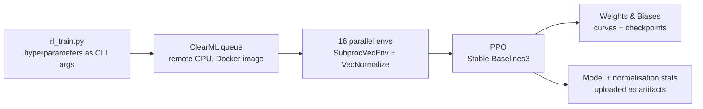

# Robotics · RL control, a tic-tac-toe arm and a humanoid

Three robotics projects from BUas (Nov 2025 – Jan 2026): a reinforcement-learning controller for a lab pipetting robot, a robot arm that plays tic-tac-toe against people, and experiments on a humanoid.

## 1. Reinforcement learning: a PPO controller for a pipetting robot
**Task:** move the pipette tip of an Opentrons OT-2 to a target point (a plant's root tip on a petri dish), in a PyBullet simulation. A group assignment in which each member built and trained their own controller.

**Environment design.** I wrapped the simulator as a Gymnasium environment:
- **Observation:** the pipette position and the goal position (x, y, z each).
- **Action:** a velocity command per axis, in [-1, 1], scaled before it goes to the simulator.
- **Reward:** minus the distance to the goal, a small penalty per step (so faster is better), and a +10 bonus on success.
- **Episode end:** success within **1 mm** of the goal, or a time limit of 1,000 steps.
- **Goals** are sampled inside the measured work envelope with a safety margin, so the agent never trains on unreachable targets.

**Training pipeline.**

- PPO with learning rate 3e-4, discount 0.995, rollouts of 512 steps per environment, batch 2,048, up to 5M timesteps.
- Observations and rewards normalised with `VecNormalize`; the statistics are saved with the model, since the policy is useless without them.
- Runs execute remotely on a ClearML GPU queue, with every run logged in Weights & Biases.

**Result.** A later version restricted to the X/Y plane was tested on five plant positions in sequence:

| Plant | 1 | 2 | 3 | 4 | 5 |
|---|---|---|---|---|---|
| Final distance | 1.6 mm | 10.0 mm | 6.8 mm | 102 mm | **reached** (step 95) |

One of five targets was reached within the 1 mm tolerance. The policy got close to most targets but stalled a few millimetres short, and on plant 4 it drove to the edge of the workspace and stayed there.

**What I took from it.** Getting the last millimetre is the hard part for a distance-based reward: near the goal the reward barely changes, so the policy has little signal to fine-tune on. In the related segmentation-to-pipette project, a SAC agent reached 0.676 mm mean error on its test targets and a tuned PID controller 0.449 mm, so the final system used PID. Things I would try next: a shaped reward near the goal (for example a log-distance term), curriculum on the tolerance, and evaluating on a fixed set of random goals instead of a single sequence.

## 2. Robot arm that plays tic-tac-toe
**Group project (Nov 2025).** A Niryo robot arm plays tic-tac-toe against a person on a real board with real pieces.
- **Vision:** the arm's camera finds the board workspace, and colour thresholding in HSV space detects the human's (red) and the robot's (blue) pieces per cell.
- **Game logic:** the full game: board state, turn handling, win and draw detection, and move choice by minimax with alpha-beta pruning (perfect play). A small neural network that scores the nine cells and a rule-based player were built as alternative strategies.
- **Action:** vacuum-pump pick-and-place of the robot's piece, with poses calibrated once and saved to JSON.
- A simulation mode runs vision and game logic without the arm, for testing.

**My part:** _TODO (fill in)._

## 3. Humanoid robot experiments
**Experimental work (Jan 2026)** on a Unitree G1 humanoid (29 degrees of freedom, dexterous five-finger hands): walking and balancing while holding objects.
- A **pose capture and replay** tool in Python on the Unitree DDS SDK: teach arm and hand poses from the keyboard, save them as a JSON pose library, and replay them as sequences, with an optional waist lock.
- Upper-body pose commands published over **ROS 2** to NVIDIA's GR00T whole-body controller, which keeps the robot walking and balanced while the arms and hands move.
- Simulation in **Isaac Sim / Isaac Lab** for testing poses, including a comparison of hand models.

This was exploratory: no benchmark or measured results.

## Limitations
- The PPO controller reached 1 of 5 targets in its final test; it was not the controller we shipped.
- The tic-tac-toe arm and the humanoid work have no measured results (detection accuracy, success rates).
- Lab hardware and course-supplied simulators, so the code is not published.

**Stack:** Python · Gymnasium · Stable-Baselines3 (PPO) · PyBullet · ClearML · Weights & Biases · OpenCV · pyniryo · TensorFlow/Keras · Unitree SDK2 (DDS) · ROS 2 · NVIDIA GR00T · Isaac Sim / Isaac Lab

*The code lives in private school repositories.*
