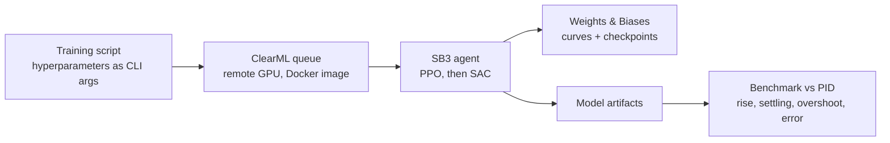
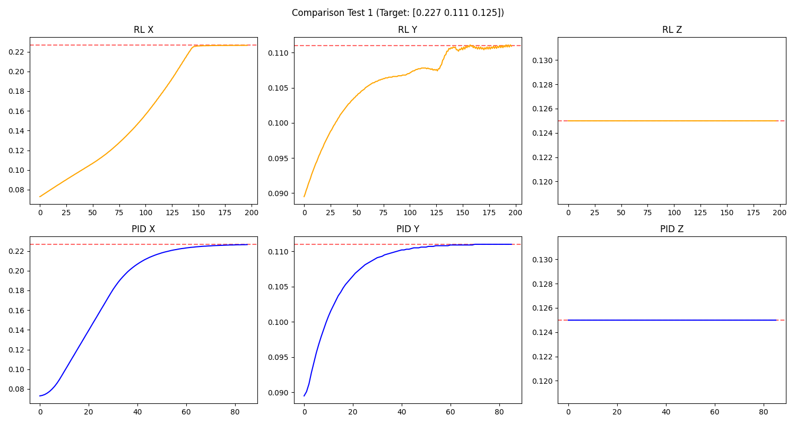
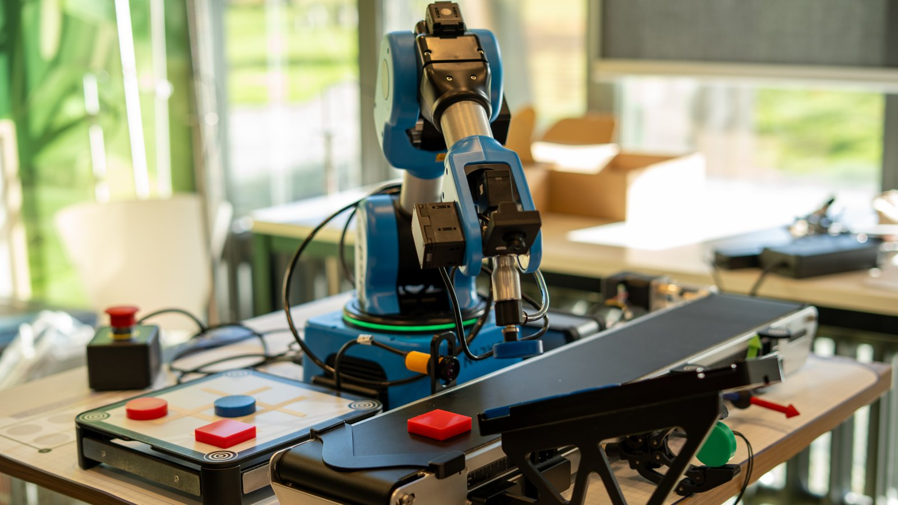

# Robotics · RL control, a tic-tac-toe arm and a humanoid

Three robotics projects (Nov 2025 – Jan 2026): a reinforcement-learning controller for a lab pipetting robot, a robot arm that plays tic-tac-toe against people, and experiments on a humanoid.

## 1. Reinforcement learning: a controller for a pipetting robot
**Task:** move the pipette tip of an Opentrons OT-2 to a target point (a plant's root tip on a petri dish) in a PyBullet simulation, within the **1 mm** accuracy the task required. Each team member built and trained their own controller; the team shared one hyperparameter search.

**First version: PPO.** I wrapped the simulator as a Gymnasium environment (observation = pipette and goal position, action = a velocity per axis, reward = minus the distance with a small time penalty and a success bonus, goals sampled inside the measured work envelope) and trained PPO on it. The policy learned to approach the targets but often stalled a few millimetres short: near the goal a plain distance reward barely changes, so there is little signal left for the last millimetre. The final version changed both the reward and the algorithm.

**Final version: SAC with a dense, progress-based reward.**
- **Simpler problem:** control in the X/Y plane with the height fixed.
- **Observation:** position, velocity and goal (x, y each), normalised to [-1, 1]. **Action:** a velocity command in X and Y.
- **Reward:** `-10 × distance` + `100 × (progress since the last step)` + a bonus of 50 within 1 mm or 100 within 0.5 mm. The progress term keeps the signal strong all the way into the goal.
- **Algorithm:** SAC (Stable-Baselines3), 3M timesteps per run.

**Training pipeline.**

- Runs execute remotely on a ClearML GPU queue (about 6 hours per 3M-step run), every run logged in Weights & Biases.
- For PPO: 16 parallel environments with observation and reward normalisation (`VecNormalize`), the statistics saved with the model.
- Hyperparameters: five configurations (one per team member) over learning rate, replay buffer, batch size, tau, discount and entropy; the best one was used.

**Result.** Benchmarked against a tuned PID controller on three random targets:

| Target | RL final error | PID final error |
|---|---|---|
| 1 | 0.47 mm | 0.45 mm |
| 2 | 0.76 mm | 0.49 mm |
| 3 | 0.80 mm | 0.41 mm |
| **Mean** | **0.68 mm** | **0.45 mm** |

The RL controller met the 1 mm requirement on every target, without overshoot. PID was still more precise and settled faster (0.3 s against 3.1 s on average), so the integrated pipeline in the [plant-root project](plant-root-phenotyping.md) uses PID. The RL policy, however, learned the task from the reward alone, with no model of the robot.

## 2. Robot arm that plays tic-tac-toe
**Team project (Nov 2025).** A Niryo robot arm plays tic-tac-toe against a person on a real board with real pieces.

- **Vision:** the arm's camera finds the board workspace, and colour thresholding in HSV space detects the human's (red) and the robot's (blue) pieces per cell.
- **Game logic:** the full game: board state, turn handling, win and draw detection, and move choice by minimax with alpha-beta pruning (perfect play). A small neural network that scores the nine cells and a rule-based player were built as alternative strategies.
- **Action:** vacuum-pump pick-and-place of the robot's piece, with poses calibrated once and saved to JSON.
- A simulation mode runs vision and game logic without the arm, for testing.

**My part:** the execution algorithm (turning the chosen move into the arm's pick-and-place sequence), and help with the piece detection.

## 3. Humanoid robot experiments
**Experimental work (Jan 2026)** on a real Unitree G1 humanoid (29 degrees of freedom, dexterous five-finger hands): walking and balancing while holding objects.
- A **pose capture and replay** tool in Python on the Unitree DDS SDK: teach arm and hand poses from the keyboard, save them as a JSON pose library, and replay them as sequences, with an optional waist lock.
- Upper-body pose commands published over **ROS 2** to NVIDIA's GR00T whole-body controller, which keeps the robot walking and balanced while the arms and hands move.
- Simulation in **Isaac Sim / Isaac Lab** for trying poses before running them on the robot, including a comparison of hand models.

This was exploratory: no benchmark or measured results.

## Limitations
- The RL benchmark covers three targets, in simulation only.
- The tic-tac-toe arm and the humanoid work have no measured results (detection accuracy, success rates).
- Lab hardware and third-party simulators, so the code is not published.

**Stack:** Python · Gymnasium · Stable-Baselines3 (SAC, PPO) · PyBullet · ClearML · Weights & Biases · OpenCV · pyniryo · TensorFlow/Keras · Unitree SDK2 (DDS) · ROS 2 · NVIDIA GR00T · Isaac Sim / Isaac Lab

*The code lives in private repositories.*
