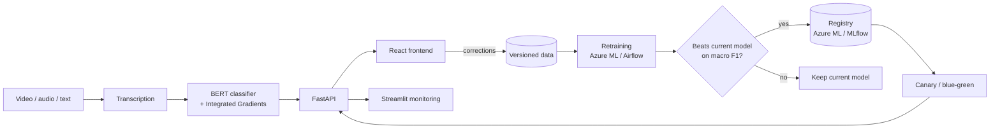

# Sentify · Emotion-classification MLOps pipeline

**For a media-production client: give it a video or audio clip, get back a transcript with an emotion label and confidence for every sentence.**

A team project (April–June 2026) focused on everything around the model: packaging, serving, monitoring, and a retraining loop that only promotes a new model when it is measurably better, with the same package running in Azure and on an on-premise server.

## Model
- Fine-tuned **BERT** over seven classes (Ekman's six plus neutral).
- A first setup collapsed to low-confidence predictions at macro F1 0.41; focal loss with AdamW at a lower learning rate brought it to **macro F1 0.84**.
- **Integrated Gradients** show which words drove each prediction.

## Architecture

## Retraining and rollout
- User corrections become versioned training data; retraining runs as an Azure ML pipeline in the cloud and as an Airflow DAG on-premise.
- Retraining warm-starts from the current model with tight limits (2 epochs, learning rate capped at 1e-5), so small feedback batches don't pull it far from what already works.
- A **registration gate** registers a candidate only if it beats the current model on macro F1, which weighs every emotion equally. Both registries (Azure ML and MLflow) sit behind one interface, so the same gate runs in both environments.
- Promotion to production stays a manual approval. On Azure, a new version goes out as a **canary** (20% of traffic) or **blue/green**, using a promotion script.

## Two environments, one package
- **Cloud (Azure ML):** GPU training, hyperparameter sweeps, scheduled retraining, data versioned in Blob Storage, managed online endpoints.
- **On-premise (Portainer):** Docker Compose stack with the React frontend, FastAPI backend (`/predict`, `/feedback`, `/jobs`), Streamlit dashboard, and a self-hosted MLflow with Postgres and MinIO. Inference runs on CPU.
- **Cost:** running the cloud endpoint on weekday working hours instead of always-on brings it from about €152 to €55 a month (estimate from public prices).
- Installable Python package with a Typer CLI; 560 tests at 83% coverage (80% minimum enforced), run in CI on every pull request.

## My part
The model lifecycle: the Azure ML retraining pipeline and its fine-tune mode, the registration gate and the shared registry interface, the `/jobs/register` endpoint that connects the on-premise Airflow run to the gate, canary and blue/green deployment with a comparison of the strategies, the self-hosted MLflow stack (image built in CI and published to GHCR), most of the unit tests, and the cost estimate.

## Limitations
- Monitoring is a dashboard without alerting or drift detection.
- Canary promotion and deployments are started by hand.
- One model architecture and a small dataset.

**Stack:** PyTorch · Transformers · FastAPI · Typer · React · Streamlit · MLflow · Airflow · Postgres · MinIO · Docker Compose · Portainer · Azure ML · GitHub Actions

*The code lives in a private repository.*
